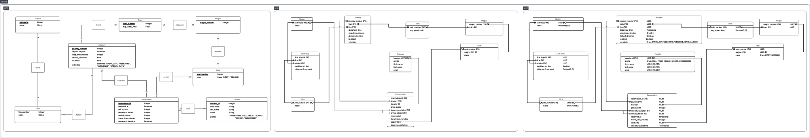

# Data Architecture Decision Note

## Network

A station can belong to several lines, which is what makes connections possible. The `serve` association becomes the `line_stop` table. It carries `position_on_line`, which orders the stations of a line, and `distance_from_next`, which is used to compute trip distances.

## Journeys

A journey is a train running on a line at a given `departure_time`. The `schedule` enum (EVERY_DAY, WEEKDAYS, WEEKENDS, SPECIAL_DAYS) defines the days it runs. Arrival and departure times at each station are derived from the line distances, `avg_speed_kmh` and `stop_time_minutes`. `is_direct` and `default_direction` describe how the journey runs along the line.

## Rolling stock

A train is composed of wagons, and each wagon contains seats. The comfort class is held by the seat (`FIRST`, `SECOND`).

## Reservations

A reservation links a traveler, a journey, a seat and two stations (departure and arrival). The seat is therefore booked for a segment, not for the whole journey, so it can be resold for the rest of the trip. The price is frozen at purchase time in `price_cents`: storing it as an integer avoids floating-point rounding errors.

## Physical model

- Primary keys are UUIDs.
- Closed lists (class, profile, schedule) are enums.
- Text columns are bounded `VARCHAR`s.
- Small counters use `SMALLINT`.
