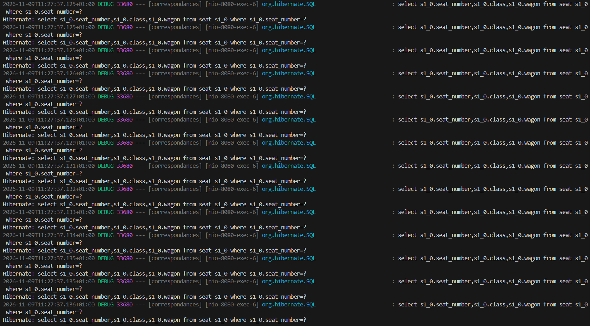
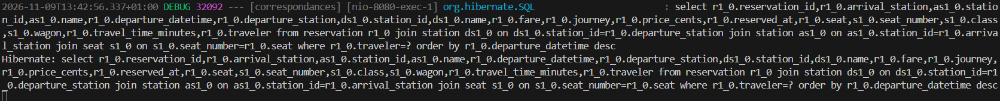

# PostgreSQL Query Optimization and N+1 Problem Resolution

## 1. Finding a Traveler with Existing Reservations

To set up our optimization benchmark, we identify the traveler with the highest volume of reservations in the table:

```
SELECT 
    traveler, 
    COUNT(*) AS total_reservations
FROM reservation 
GROUP BY traveler 
ORDER BY total_reservations DESC 
LIMIT 1;

```

## 2. Test Case Selection

We note the following target UUID:

* **Traveler UUID:** `51588818-2240-4d5b-85bb-ff8dee5643c6`

## 3. Execution Plan Analysis Before Optimization

### Context:

* **API Endpoint:** `GET /travelers/{travelerId}/reservations`

* **Spring Data Method:** `findByTravelerTravelerIdOrderByDepartureDatetimeDesc(travelerId)`

* **Current Behavior:** The engine must scan all 500,000 reservations, filter the entries matching the traveler ID, and then sort the results by departure datetime.

### Target Query

```
EXPLAIN (ANALYZE, BUFFERS)
SELECT *
FROM reservation
WHERE traveler = '51588818-2240-4d5b-85bb-ff8dee5643c6'::uuid
ORDER BY departure_datetime DESC;

```

### Execution Plan Result

```
Gather Merge  (cost=23859.32..23870.97 rows=100 width=136) (actual time=154.387..165.106 rows=100.00 loops=1)
   Workers Planned: 2
   Workers Launched: 2
   Buffers: shared hit=3761 read=16569
   ->  Sort  (cost=22859.30..22859.40 rows=42 width=136) (actual time=82.328..82.334 rows=33.33 loops=3)
         Sort Key: departure_datetime DESC
         Sort Method: quicksort  Memory: 40kB
         Buffers: shared hit=3761 read=16569
         Worker 0:  Sort Method: quicksort  Memory: 25kB
         Worker 1:  Sort Method: quicksort  Memory: 25kB
         ->  Parallel Seq Scan on reservation  (cost=0.00..22858.17 rows=42 width=136) (actual time=65.709..82.134 rows=33.33 loops=3)
               Filter: (traveler = '51588818-2240-4d5b-85bb-ff8dee5643c6'::uuid)
               Rows Removed by Filter: 166633
               Buffers: shared hit=3685 read=16569
 Planning:
   Buffers: shared hit=15
 Planning Time: 0.279 ms
 Execution Time: 165.192 ms

```

### Diagnosis

* **Disk I/O:** `read=16569` blocks read directly from disk (1 block = 8 KB default in PostgreSQL).

* **Full Scan:** Execution of a `Parallel Seq Scan` across 500k rows.

* **Total Execution Time:** **165.19 ms**.

## 4. Composite Index Creation

To eliminate both the sequential scan and the explicit in-memory sorting step, we create a composite index:

* **Column 1 (`traveler`):** Equality filter (`WHERE traveler = ...`).

* **Column 2 (`departure_datetime DESC`):** Keeps data pre-sorted to satisfy the `ORDER BY` clause directly.

```
CREATE INDEX idx_reservation_traveler_date 
ON reservation (traveler, departure_datetime DESC);

```

## 5. Execution Plan Analysis After Optimization

### Execution Plan Result

```
Sort  (cost=388.69..388.94 rows=100 width=136) (actual time=1.175..1.197 rows=100.00 loops=1)
   Sort Key: departure_datetime DESC
   Sort Method: quicksort  Memory: 40kB
   Buffers: shared read=6
   ->  Bitmap Heap Scan on reservation  (cost=5.20..385.37 rows=100 width=136) (actual time=0.747..1.018 rows=100.00 loops=1)
         Recheck Cond: (traveler = '51588818-2240-4d5b-85bb-ff8dee5643c6'::uuid)
         Heap Blocks: exact=3
         Buffers: shared read=6
         ->  Bitmap Index Scan on idx_reservation_traveler_date  (cost=0.00..5.17 rows=100 width=0) (actual time=0.316..0.317 rows=100.00 loops=1)
               Index Cond: (traveler = '51588818-2240-4d5b-85bb-ff8dee5643c6'::uuid)
               Index Searches: 1
               Buffers: shared read=3
 Planning:
   Buffers: shared hit=18 read=1
 Planning Time: 13.469 ms
 Execution Time: 1.464 ms

```

### Before / After Comparison

| Metric | Before Indexing | After Indexing | Improvement | 
| ----- | ----- | ----- | ----- | 
| **Access Method** | `Parallel Seq Scan` | `Bitmap Index Scan` | Direct target lookup | 
| **Scanned Rows** | 500,000 | 100 | 5,000x reduction | 
| **Read Buffers (`read`)** | 16,569 blocks (\~132 MB) | 6 blocks (\~48 KB) | Disk I/O reduced by \~2,700x | 
| **Estimated Cost (`cost`)** | \~23,870 | \~388 | Major reduction | 
| **Execution Time** | **165.19 ms** | **1.46 ms** | **\~113x faster** | 

## 6. JPA / Hibernate N+1 Problem

### Definition

The $N+1$ query problem occurs when an ORM (such as Hibernate) executes:

1. **1 initial query** to retrieve a list of $N$ parent entities.

2. $N$ **additional queries** to lazily fetch associated child relations (`FetchType.LAZY`).

### Service Layer Context

In `TravelerService`, Spring Data fetches 100 reservations and maps them to DTOs:

* `reservation.getDepartureStation().getName()` (departure station)

* `reservation.getArrivalStation().getName()` (arrival station)

* `reservation.getSeat().getSeatClass()` (seat details)

**Consequence:**
For 100 reservations, the application performs: 1 initial query + $100 \times \text{station queries}$ + $100 \times \text{seat queries}$, resulting in hundreds of redundant database round-trips.

### Verification and Fix Workflow

1. **Enable SQL Logs:** Turn on Hibernate SQL statement logging.

2. **Execute Initial Benchmark Request:**

   * Call endpoint: `GET http://localhost:8080/travelers/51588818-2240-4d5b-85bb-ff8dee5643c6/reservations`

   

3. **Eager Fetch via `JOIN FETCH` or `@EntityGraph`:** Instruct JPA to fetch stations and seats in memory in the primary query (see commit):

   ```
   @Query("SELECT r FROM Reservation r " +
          "JOIN FETCH r.departureStation " +
          "JOIN FETCH r.arrivalStation " +
          "JOIN FETCH r.seat " +
          "WHERE r.traveler.id = :travelerId " +
          "ORDER BY r.departureDatetime DESC")
   List<Reservation> findReservationsWithDetails(@Param("travelerId") UUID travelerId);
   
   ```

4. **Verify Final Execution:**

   * Re-run endpoint call: `GET http://localhost:8080/travelers/51588818-2240-4d5b-85bb-ff8dee5643c6/reservations`

   